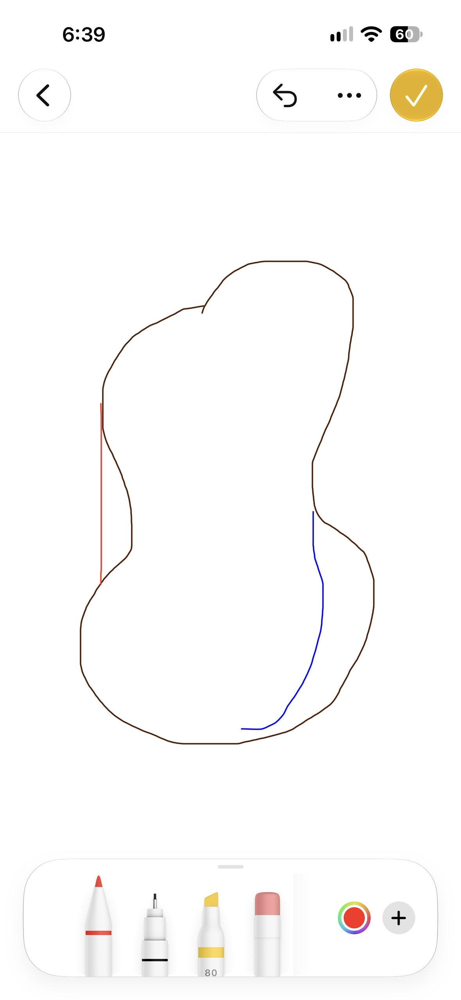

# Karts & Wheels: design document

A cartoon kart racer for Game Night, built in Godot. Friends in the same room build
their own karts, pick an animal driver, and race each other from their phones,
connected peer to peer through the same rooms, video call and relay as the other
games.

This is a living document. It is the spec the code is built from, so when a
decision changes, change it here first.

**Status key**
- **Decided**: agreed; build to this.
- **Proposed**: a recommendation waiting for a yes or no.
- **Open**: needs a decision before the work that depends on it.

---

## 1. The pitch

**Decided.** A Mario Kart–style party kart racer with its own identity:

- **Build your kart** before every race. The chassis, wheels and driver all change how it drives.
- **Animal drivers** in a bright cartoon style.
- **Tracks across different terrains**, each with its own obstacles and surfaces.
- **Original items** to collect and use. We design these ourselves, so they're not copies of Mario Kart's.
- **It feels dynamic:** screen shake on crashes, big hits and bumpy landings.
- **Steer by tilting your phone** like a steering wheel, or with on-screen buttons, a keyboard or a gamepad. Players choose.

Name: **Karts & Wheels** (Decided).

## 2. Goals and non-goals

**Proposed goals**
- From opening the room to the first race in under two minutes, kart building included. A race lasts about 2–4 minutes.
- Phone first: touch or tilt controls, 60 fps on a mid-range phone, quick to load.
- Computer drivers fill the grid, so a race is fun with only two people.
- It plugs into Game Night like the other games: same room code, lobby, video call, reconnects and relay.
- **Open for more:** tracks, kart parts, drivers and items are data plus scenes. Adding one is new content, not new engine code.
- It costs nothing to run: static files on GitHub Pages, peer to peer, no game server.

**Proposed non-goals (for the first version)**
- Realistic simulation (tire temperatures, gears, damage models).
- Online play with strangers, leaderboards or accounts.
- A track editor.
- Perfect fairness on bad networks. It's a party game among friends.

## 3. Players and platforms

| | |
|---|---|
| Karts per race | **Proposed:** up to 8 people plus bots, 8 karts total. Possibly 12 later; see 13.3. |
| Devices | Phones first (iOS Safari, Android Chrome), then desktop browsers. |
| Orientation | Landscape while racing (**Proposed**). Portrait is fine in the kart builder. |
| Session | One room plays many races in a row: single races, or a Grand Prix of every track with points (4). |

## 4. Stages of the game

**The flow (Decided, built unless marked)**

1. **Lobby.** The existing Game Night lobby. The host picks Karts & Wheels and adds bots as usual.
2. **Track picker.** The host picks one of the tracks, or **Grand Prix**, on the room page: a card for each with an aerial thumbnail and its name, nothing more. Everyone else sees who is picking. (A vote, with the host able to override, is still a possible later change.)
3. **Kart builder** (section 5). Each player picks a chassis, wheels and driver over a slow aerial tour of the track, with the kart turning on the right, then taps Ready.
4. **Fly-in.** Once everyone is ready, the camera carries on from exactly where the aerial tour was, turning the same way, and spirals down in one slow circle (8 s) to stop behind your kart, in place for the race.
5. **Countdown.** "3, 2, 1, GO", in sync across phones on the host's clock. Karts sit on a level grid and are held still until GO. **Proposed:** pressing gas right at GO gives a small launch boost.
6. **Race.** Laps, positions, a minimap, items, and screen shake on crashes.
7. **Finish.** When you cross the line, a computer driver takes over your kart for a cool-down lap and a results screen opens in the middle of the screen: your place, each lap time (the best marked), your total, and the standings filling in as the others finish. After the first finisher, the rest have 30 seconds (DNF, "did not finish", for anyone still out).
8. **Results.** The standings by the room's finishing times. **Proposed for later:** a podium with the top three drivers, and fun awards like "most items landed", "most airtime" and "biggest crash".
9. **Next.** For a single race, the host's **Race again** goes back to the track picker. In a **Grand Prix**, it's **Next race** (below).

**Grand Prix (Decided, built).** Every track in turn: Meadow Loop, Mining Mountain, then Frosty Pass. Each finish scores points as in Mario Kart: 15, 12, 10, 8, 6, 4, 2, 1 for 1st to 8th, nothing for not finishing. The room adds them up when each race ends. The results screen then shows the cup standings (total, and what each racer got that race), and the host's **Next race** takes everyone back to the kart builder, builds kept, on the next track. After the last race: final standings and the winner, then **Race again**. A banner at the start of each race says which race of the cup it is.

Reconnecting follows the platform rules. A player who drops mid-race gets their kart back if they return before the race ends; otherwise their kart is parked and they get a DNF. If the host drops, the race pauses until the host returns, as in the other games.

## 5. Kart builder

**Decided:** a build-your-kart stage before racing with **two parts for now: chassis, and wheels and tires**. The chassis sets turning and the hit box; the wheels and tires set handling and grip on each surface. More part types may come later, such as a kite or glider for jumps, so the builder is built to take new slots.
**Proposed:** the driver adds a little weight (5.4).

### 5.1 Stats (Proposed)
Everything comes down to a few stats, each shown as 1–10 bars in the builder:

| Stat | What it does |
|---|---|
| Top speed | Maximum speed on a good surface |
| Acceleration | How quickly you reach top speed, and recover after a hit |
| Weight | Who gets pushed around in a bump; heavy karts lose less speed when hit |
| Turning | Turn radius and how quickly the kart changes direction |
| Grip | How much sideways force before sliding, per surface (see 5.3) |
| Drift | How easy drifts are to start and hold, and how fast they charge boost |

The stats map onto the physics tuning in section 7, so the builder and the physics share one set of numbers.

**Open, to decide later: the balancing rules.** **Decided principle:** no part or combination is obviously the best choice. Every strength costs something, and tracks favour different builds.

### 5.2 Chassis (Decided: affects turn radius and hit box)
Each chassis sets **turning**, its **hit box** size and shape, and some **weight**. A small hit box is harder to hit with items and slips through gaps; a big one shoves others around in bumps.

**Proposed starting set (4)**

| Chassis | Feel | Turning | Hit box | Weight |
|---|---|---|---|---|
| Go-kart frame | Classic, all-round | Medium | Medium | Medium |
| Soapbox | Tiny and twitchy | Tight | Small | Light |
| Hauler | A truck of a kart, hard to push around | Wide | Large | Heavy |
| Racer | Long and low, fast but takes the long way round | Wide-ish | Long and narrow | Medium |

**Built in Blender (Decided).** Each chassis has its own body, modelled by script and fitted to its wheelbase and track:
- **Go-kart frame:** a classic sprint kart: one smooth shell from a low nose over the cowl to the engine cover, front fenders, a bucket seat, twin exhausts.
- **Soapbox:** a teardrop gravity racer on wooden axle beams, with a brake lever, a tail fin and a little windscreen. No engine.
- **Hauler:** a chunky work truck: grille, headlights, bull bar, black arches over fat wheels, a roll cage and tall exhaust stacks.
- **Racer:** a long, low single-seater: needle nose, front and rear wings, sidepods, an air intake behind the driver, twin exhausts.

### 5.3 Wheels and tires (Decided: affect handling and friction on the road)
Tires set **grip, handling and drift**, and how much grip they keep **on each surface**. This is where track choice matters: pick tires for the terrain.

**Proposed starting set (4)**

| Tires | Asphalt | Dirt and grass | Sand and mud | Ice and snow | Notes |
|---|---|---|---|---|---|
| Slicks | Excellent | Poor | Poor | Poor | Best on clean tracks |
| Knobby off-road | Fine | Excellent | Good | Fine | Bumpier ride, slower top speed |
| Balloon | Fine | Good | Excellent | Fine | Bouncy; lands jumps softly |
| Studded | Fine | Fine | Poor | Excellent | Built for ice and snow |

### 5.4 Drivers: animals (Decided: one shared base body with animal features)
**Decided:** drivers don't need to be anatomically correct. Every driver is built on **the same simple, rounded base body**: a soft bean or teddy shape with a big head, stubby arms and legs, in the spirit of Among Us or the Teletubbies. Each animal is recognised by a few **defining features** and its **colours**:

| Driver | Defining features | Colours |
|---|---|---|
| Fox | Tall pointed ears, a bushy white-tipped tail | Orange with white |
| Frog | Bulging eyes on top of the head, a wide smile | Bright green |
| Red panda | Round ears, a striped ringed tail, a white face mask | Rust red with cream |
| Hedgehog | A crown of soft spikes on the back of the head | Brown with tan |
| Corgi | Big triangle ears, a stubby tail | Orange and white |
| Otter | Small round ears, whiskers, a thick tapering tail | Chocolate brown |
| Raccoon | A black eye mask, a ringed tail | Grey and black |
| Rhino | A nose horn, small ears | Slate grey |
| Deer | Antlers, white spots on the back | Fawn |
| Capybara | A blunt square snout, tiny ears, a calm face | Sandy brown |
| Bear | Round ears, a muzzle patch | Dark brown |

**Proposed:** launch with 8 of these. If one turns out hard to make readable, swap it for another (**Decided**: the roster can change). Features are separate small parts that attach to standard points on the base body (head top, face, back, tail). So a new animal is mostly new features, new colours and a name. Each driver has a light weight class (small, medium or large). It changes the base body's scale a little and adds weight to the kart.

**Built: fox, frog, rhino and deer (Decided for launch).** More can come from the table above.

**Racers, not mascots (Decided).** They began cute (big sparkly eyes, pink cheeks, a "w" smile); the user asked to turn that down so they look like racers with a competitive glint. Now: narrowed eyes under heavy lids that slant down toward the nose and a hard brow, so they glare; one sharp glint in each eye; a lopsided smirk; no blush; longer, slyer muzzles on the fox and deer; and racing goggles pushed up on the forehead (the frog, whose eyes are on top of its head, wears a red sweatband). Proportions stay chibi: a big head on a small body.

**Sculpted in Blender (Decided).** `racing/tools/blender/drivers.py` builds each animal from soft shapes (ellipsoids, capsules, tapered cones) joined with a smooth blend, so an ear grows out of the head with a rounded join instead of a cone stuck on a sphere. Colour patches (belly, muzzle, inner ears, ear tips, tail tip) are painted into the surface. Eyes, lids, brows, nose, mouth and goggles are small separate pieces. The fox's tail and the deer's antlers are separate so they still wobble. Each driver has a seated body and a standing, waving one (for the lobby). About 6,500 triangles each in a race.

### 5.5 Every combination works and looks good (Decided)
Any chassis with any wheels and any driver has to drive properly and look right. **Proposed** rules that guarantee it:
- **Standard mounting points.** Every chassis model has named attachment points: four wheel mounts, a driver seat, a rear item rack, and a top mount reserved for future parts like a kite. Wheels and drivers snap to those points, so nothing floats or clips.
- **Wheel sizes stay in a range.** Each chassis says how big its wheels can be; wheels scale to fit within it. Suspension and ride height adjust automatically, so the kart never sits on its belly or on stilts.
- **One seat pose for every driver.** All drivers share the same seated proportions at the hips and hands, so any animal fits any seat and reaches the wheel (9.2).
- **The hit box comes from the chassis only,** so changing wheels never changes how you collide.
- **An automatic check of every combination.** A test builds every chassis × wheels × driver combination and renders a contact sheet of screenshots for review. It fails if a wheel or driver clips through the body.

### 5.6 Keeping it fair (Proposed)
All builds should finish within about 5% of each other on a lap when driven well (to confirm when we decide the balancing rules). Bots use preset balanced builds.

## 6. Items

**Decided:** items you collect on the track, designed by us so they aren't copies of Mario Kart.
**Proposed rules:** item crates sit in rows across the track and reappear 3 seconds after being picked up. You hold one item at a time. What you get depends on your position: karts near the back get more catch-up items.

**Decided launch items:** the **honey puddle**, the **tumbleweed** and the **growing snowball**, all built.
**Decided:** each track has its own item pool, so items match the terrain. For now the snowball comes only from crates on Frosty Pass; honey and tumbleweeds come everywhere.

| Launch item | What it does | Where |
|---|---|---|
| **Honey puddle** | Dropped behind you. It grabs: a kart that drives into it loses half its speed at once, then is held to 45% and steers sluggishly for 2 seconds. It lasts 15 seconds or until 3 karts have driven through it | All tracks |
| **Tumbleweed** | Rolled backwards down the track. It bounces unpredictably and knocks karts sideways | Meadow Loop, Canyon Run, dry tracks |
| **Snowball** | Bowled forward along the track, faster than any kart. It grows as it rolls (from about 1 m across to 3 m), so the further it travels, the bigger the hit. It bursts on the first kart it reaches (knocking it aside and nearly stopping it) or when it leaves the road | Frosty Pass |

**Candidates for later** (each fills a role every kart racer needs, with our own twist):

| Role | Item idea | What it does |
|---|---|---|
| Forward shot | **Acorn volley** | Three bouncing acorns fired ahead. Each that hits makes a kart wobble |
| Seeks someone | **Bee swarm** | Chases the kart directly ahead of you, and can be shaken off by drifting |
| Self boost | **Tailwind** | A strong gust behind you: a boost that also pushes nearby karts aside |
| Defense | **Bubble** | Absorbs one hit, then pops |
| Escape | **Burrow** | Dig underground for 3 seconds: you can't be hit and pass under obstacles, but you can't steer much |
| Chaos | **Party dice** | A game-night item: roll for a random effect, good or bad |
| Catch-up | **Slipstream rope** | Latches onto the kart ahead and slingshots you past it |
| Field effect | **Fog horn** | Blows fog over the screens of everyone ahead of you for a few seconds (lighter fog for those further ahead) |

**Built (first items, Meadow Loop):**
- **Crates:** two rows of glowing crystal crates across the cave route. They come back 3 seconds after being picked up. That's another reason to take the cave.
- **Roulette:** picking one up spins through the icons for under a second, then you hold the item until you use it (item button, or E).
- **Honey puddle:** works as in the table above: slow and sluggish steering for 2 seconds, lasting 15 seconds or 3 karts.
- **Tumbleweed:** rolls backwards down the road from your kart, wandering and hopping. A hit shoves you sideways and slows you, but never spins you round or flips you.
- **Snowball:** as in the table. Computer drivers bowl it at a kart up to 45 m ahead.
- **Coins:** rows of spinning coins on the road, each +1% top speed up to 10; an item hit costs 3. **Decided:** they run in diagonal lines across the road, alternating direction, so collecting a whole line takes steering.
- **Item boxes:** a squishy pink jelly cube with a fat yellow question mark inside, its hook curling well down (drawn as a stroke, not taken from a font).
- **Computer drivers** use an item when someone is close behind them, or after 8 seconds.
- **Online:** using an item is sent to everyone so every game shows it, and each game only applies hits to the karts it drives.

### 6.1 Showing the item you're holding (Decided: both)
Two ways to show the player what they can use next. They can be combined:
- **A. On the item button itself (Proposed as primary).** The big item button on the right of the screen shows the held item's icon, with a short "spin" while the crate's item is picked. Your eye and your thumb are already there, so nobody has to look away from the road.
- **B. On the back of the kart (Proposed as an extra).** The held item sits on the kart's rear rack: a honey pot, a tumbleweed, a snowball. It's cute, it tells the karts behind you what's coming, and it adds a little strategy. It's only a few triangles per kart.

## 7. Physics

Godot runs physics 60 times a second (fixed timestep) on every phone. Each phone simulates **its own kart**; section 13 explains why.

### 7.1 Kart model (Proposed)
A **custom arcade kart on a `RigidBody3D`**, not Godot's `VehicleBody3D`. It's easier to tune for fun, and it behaves the same on every device. Every number comes from the kart's build (section 5).

| System | How it works | Set by |
|---|---|---|
| Suspension | 4 downward rays, each a spring and damper holding the body up | Chassis (balloon tires add bounce) |
| Engine and brakes | Forward force from a speed-to-force curve | Top speed and acceleration (motor if 5.5) |
| Grip | Sideways force that cancels sliding, per axle, from a simple slip curve, multiplied by the surface | Tires (by surface) |
| Turning | Turn radius from the chassis, which widens a little at speed | Chassis |
| Drift | Hop into a drift; rear grip drops and turning tightens. Holding it charges a 3-stage boost | Tires and drift stat |
| Weight | Mass, which decides who gets pushed in bumps and how much speed you lose when hit | Chassis plus driver |
| Hit box | A simple box or capsule for bumps and item hits, sized per chassis | Chassis |
| Downforce | Extra downward push at speed, so karts stay planted | Shared |
| Air | Mild self-levelling in the air; balloon tires soften landings | Shared and tires |
| Surfaces | Each patch of track has a type: asphalt, dirt, grass, sand, mud, ice, snow, boost pad or rough. It scales grip and drag | Track |
| Recovery | Off the world, upside down for 2 seconds, or stuck for 3: respawn on the track at the last checkpoint | Shared |

### 7.2 Collisions and crashes (Proposed)
- **Walls:** glancing hits slide along; head-on hits stop you and bounce you back a little. Speed lost depends on the angle.
- **Kart to kart:** your phone treats the other karts as solid shapes moving where the network says they are. A bump pushes your own kart according to the two weights, and their phone does the same for theirs. The push is capped so a lag spike can't launch anyone.
- **Item hits:** the phone of the kart that gets hit decides whether it was hit (13.4), then plays the spin-out or wobble.
- **Obstacles:** solid ones (rocks, logs) act like walls; moving ones (rolling barrels, swinging gates) follow a timed pattern, so every phone sees them in the same place.

### 7.3 Screen shake and feel (Decided: shake on crashes)
**Proposed:** a "trauma" value from 0 to 1 that crashes add to. Shake strength is trauma squared, so small bumps barely shake and big crashes really do. Trauma fades over about half a second.

| Event | Trauma added |
|---|---|
| Light bump with a kart | 0.15 |
| Wall hit | 0.2–0.6, by impact speed |
| Hit by an item | 0.5 |
| Hard landing after a jump | 0.3 |
| Big explosion or chaos item | 0.7 |

Also on crashes: a short camera field-of-view punch, sparks and dust, and a vibration on Android phones (iPhone browsers don't allow vibration). A **reduced shake** setting has three levels: full, gentle and off. It follows the phone's reduced-motion setting by default.

### 7.4 What the physics doesn't need
Exact determinism across devices. Each kart has one owner, and everyone else shows that owner's version, which avoids the hardest problem in networked physics.

## 8. Tracks

**Decided:** different terrains and obstacles, launching with one or two tracks from the candidate list and built so more can be added. Every track has background scenery (sky, distant land, trees) **and** scenery that affects play (trees you can crash into, guardrails along a highway, fences, rocks).

### 8.1 How a track is built (Proposed)
Each track is one Godot scene plus a `TrackInfo` resource:
- A **racing line** (`Path3D`), used for bots, positions, respawns and the minimap.
- **Checkpoints**: 8–16 invisible gates. A lap counts only when you pass them all in order.
- **Surface areas**, painted on the track so the physics knows what you're driving on.
- **Obstacles**, made from reusable pieces (rolling, swinging, sliding, popping up, static).
- **Item crate rows**, boost pads, jumps and at least one shortcut.
- A **starting grid** of 8 spots, plus lap count defaults.

Adding a track means building the scene and adding one entry to the track list. No code changes.

### 8.2 Scenery (Decided: background and gameplay scenery)
Every track has three layers:

| Layer | Purpose | Examples | Cost on phones |
|---|---|---|---|
| **Sky and far background** | Sets the mood and time of day; never touched | A stylised gradient sky with drifting clouds, the sun, distant mountains or a skyline as flat cut-outs | Very cheap: a few large flat shapes |
| **Middle scenery** | Makes the world feel alive beside the track | Trees, farms, windmills, crowds of animal spectators that cheer as you pass, birds | Cheap: one model repeated many times (instancing), simplified far away |
| **Gameplay scenery** | Things you can hit, use or avoid | Trees and rocks just off the track that stop you, guardrails along a highway that you scrape along, fences, hay bales that burst, water you have to jump | Has simple collision shapes; placed carefully so it punishes mistakes without feeling unfair |

**Proposed rules for gameplay scenery:** anything you can hit looks solid, and anything you can't hit looks soft or distant. Guardrails slide you along instead of stopping you dead. Trees and rocks sit far enough off the racing line that only a real mistake hits them.

### 8.3 Candidate tracks (Decided: launch with Meadow Loop plus one terrain track; we design each together)

| Track idea | Terrain | Obstacles and gimmicks | Good tires |
|---|---|---|---|
| **Meadow Loop** | Asphalt and grass | Gentle hills, a farm gate, a **highway stretch with guardrails**, trees lining the grass, a beginner-friendly layout | Slicks |
| **Canyon Run** | Dirt and sand | Jumps over gaps, rolling tumbleweeds, a dusty shortcut | Knobby or balloon |
| **Frosty Pass** | Snow and ice | Icy hairpins, sliding snowballs, a frozen lake shortcut | Studded |
| **Bayou Boardwalk** | Mud and wooden planks | Swinging lanterns, mud pits, logs rolling across | Balloon |
| **Kitchen Counter** | Countertop, a tablecloth | Toy-scale race past rolling fruit and a spinning lazy Susan | Any |
| **Mining Mountain** (the user's idea, built) | Rock, dirt, wooden planks, mine-cart rails | See below | Knobby |

**Mining Mountain (Built; first named Mine Shaft).** The course weaves in and out of a mountain:
- **Outside**, it runs along cliff ledges where one side drops away and the other side is the mountain face.
- **Inside**, it runs through tunnels held up by old wooden beam supports, lit by flaming wall torches that flicker.
- **Coal piles** in the tunnels slow you a little if you drive into them. Coal dust splatters across your screen and slowly blows away.
- **A mine-cart rail section** crosses a deep, dark cavern. Stay on the rails or fall into the cavern (and get put back on the track).

**Layout (the user's sketch, `docs/racing/mine-shaft-sketch.png`):**



- **Brown, the main loop:** runs round the outside of the mountain on a ledge, with the cliff dropping away on the right.
- **Blue, through the mountain:** the mine tunnel, with a cavern in the middle. It's shorter, but you have to dodge coal piles and other obstacles.
- **Red, the bridge shortcut:** a wooden rope bridge on the other side. It sways back and forth in the wind, which makes it easy to fall off.

**As built** (`racing/scripts/track/mine_track.gd`, with `sway_bridge.gd`, `coal_piles.gd`, `flicker_light.gd`):
- **The ledge:** about 1,350 m round, climbing and dipping along the mountain's side. The mountain is a heightfield rising from the road's inside edge to snow at the top; the outside edge has fences on the corners and a drop to the valley.
- **The tunnel:** a timber-framed rock tunnel through the mountain, lit by flickering torches, with item crates, coal piles (slow you and splatter your screen) and a cavern in the middle crossed on a narrow mine-cart trestle over a dark pit. Fall off and you're put back on the trestle's route a few metres back.
- **The rope bridge:** plank segments that sway sideways, roll and sag in a slow wind cycle. Fall off and you're put back on the ledge below it.
- **Computer drivers:** split between the routes lap by lap. Easy drivers leave the bridge alone, anyone who falls off it keeps to the ledge for the rest of that lap, and on the trestle and bridge they drive down the middle.
- **Joining roads:** where a route comes back in at a steep angle, the shared piece of road squares up with the main road and follows its bank, so there's no gap or lip at the join (this also fixed a hole karts could fall through).

**Mining Mountain, later changes (2026-11-07):**
- A timber portal at each tunnel mouth (posts, a header beam, braces) with a **MINE** sign over the way in; the cuttings leading in and out are lined with layered rock slabs.
- The mountain is whole from the air: over the tunnel it arches over the tunnel's rock shell instead of leaving a gap, and that surface is only for looking at (as solid ground it upset the karts below).
- The rope bridge spans a **ravine**: a gorge falls from the road edge to a floor 20 m below the deck, with a rocky ridge on the far side, instead of hanging over open air. Falling in still resets you.
- The orange dirt stretch is darker ochre gravel with ruts, like the rest of the road.

**Decided launch tracks:** **Meadow Loop**, **Mining Mountain** and **Frosty Pass**, all built. The rest stay on the list for later.

**Frosty Pass (Built, 2026-11-07).** A snowy mountain pass, about 1,340 m round (`racing/scripts/track/frost_track.gd`):
- **The climb:** up two **icy hairpins** from the start straight (low grip: studded tyres shine), over a summit with **snowdrifts**.
- **The descent:** a boost pad, then **giant snowballs** that roll across the road one after another. They run on the race clock (the host's, online), so every phone sees them in the same place. One knocks you sideways.
- **The frozen lake (Decided: on the main line).** The descent aims straight at an **ice gateway** hung with icicles, and the racing line runs across the lake, in a **glacier basin** (jagged blue-white walls round the shore, gapped where the roads come in, which also catch anyone sliding off the ice). The ice is open and slippery, with **nine holes** spread across the width, each ringed with broken ice. Over a hole the ice gives way and pulls you down, even flat out.
- **Under the ice:** you land on a **sunken road** with kelp swaying, light through the holes and a blue-green tint. It has **boost strips** with **solid boulders** between them, and a row of item boxes, and it climbs back out through an opening at the far shore: high risk, high reward. The bed is level with the road, and the ramp out has sloped sides, so sliding off never strands you.
- **The detour:** the old road round the bottom of the pass, longer but solid, peels off before the gateway.
- **Look:** snow-laden pines and snowmen (Blender), snow on the ground and banks, blue and white kerbs, snow-capped backdrop peaks, a frosted ice road, and a **Frosty Pass** arch in rounded letters.

**Start arches (Decided):** each track's name in lettering that suits it: *Meadow Loop* in a soft rounded script (Pacifico), **MINING MOUNTAIN** in chunky squared-off stencil (Black Ops One), **Frosty Pass** in rounded block letters (Lilita One). The fonts are free (SIL Open Font License), with their licences in `racing/assets/fonts/`.

**Scenery rule (Decided):** the scenery must be complete wherever the camera can be, including the fly-in from high above: no holes in a mountain, no flat ground ending short of the backdrop, no sky showing through anything.

## 9. Characters and art style

### 9.1 Look and performance
**Decided:** a cartoonish, Mario Kart–like style with animal characters.
**Decided (2026-11-07): soft, glossy shading and no outlines, as in Mario Kart.** Mario Kart has no black ink outlines: light, rim light and reflections shape everything. So:
- **Karts and drivers** use their own shader (`shaders/kart.gdshader`): soft but definite sunlight, a clear highlight, a lit rim on the edges, and a cheap reflection of the sky (a sky-to-ground gradient, strongest at grazing angles) that makes paint look glossy. Fur and rubber have no gloss. Its fill light is neutral: with the renderer's blue sky light, soft-shaded red went pink and yellow went tan.
- **Blender models bake ambient occlusion** into their vertex colours when they export (`tools/blender/common.py`), so creases, wheel wells and undersides are darker for free at run time.
- **Scenery** uses soft wrap-around light instead of hard cartoon steps, and less of the sky's blue in its fill light. The trees and bushes are our smooth Blender ones (puffy tree, pine, round tree, cluster bush; snow pines on Frosty Pass), replacing the faceted kit models.

**To keep phones fast:**
- **Look:** chunky, rounded, toy-like shapes; bright saturated colours, in Godot's Compatibility renderer.
- **Materials:** one shared colour-palette texture for everything, with no detailed texture maps. That makes downloads small and drawing fast.
- **Lighting:** baked into the track, with soft "blob" shadows under karts instead of real-time shadows.
- **Kart assembly:** at race start, each kart's chassis, wheels and driver are merged into as few meshes as possible. Eight karts cost about 16 draw calls, not 80.
- **Level of detail:** karts further away switch to simpler versions; distant scenery is plain silhouettes.
- **Budget per kart:** body up to 7,000 triangles, each wheel 2,400, the driver about 6,500 (models are thinned to their budget when exported), at most around 150 draw calls on screen.
- **Quality settings (Decided):** everyone starts on **Low**, remembered per device once raised in the garage (Low, Medium, High); Low draws the 3D view at 0.6 MP, without kart-shaped shadows, with small scenery at 45% range. It still steps down by itself if the frame rate drops.

### 9.2 Driver animation (Decided: believable, not rigid)
Drivers have to look alive: body parts move believably and react to what the kart is doing. **Proposed** approach, layering simple animations with movement worked out live from the kart's physics:

| Layer | What it does | Driven by |
|---|---|---|
| Base pose and loops | A seated idle with breathing and blinking; looping clips for driving, getting hit, celebrating and taunting | Hand-made animations |
| Hands on the wheel | Hands stay gripping the wheel as it turns; the arms bend to follow (inverse kinematics) | The kart's steering angle |
| Leaning | The upper body and head lean into turns, against the sideways force; the head looks into the corner | Sideways force, the steering input |
| Bumps and landings | The body bobs and squashes on landings and settles back with a little overshoot | The suspension |
| Floppy parts | Ears, tails, cheeks and scarves swing and bounce with momentum | Spring bones (Godot's `SpringBoneSimulator3D`) |
| Reactions | Looking at a kart overtaking or an incoming item; flinching at crashes; looking back when holding the look-back button | Game events |
| Speed and boost | Fur and ears pushed back at high speed, an excited face during boosts | Speed, the boost state |

**Proposed rig:** the shared base body (5.4) has one seated skeleton: spine, neck, head, two arms with hands, legs, plus chains for tails and long ears. That's about 25–35 bones. Because every driver uses the same body, animations and the rules above work for every animal, and every driver fits every chassis (5.5). Feature parts that should move (ears, tails, antlers wobbling slightly) attach to spring bones. Animation and spring-bone updates for faraway karts run less often, to save phone power. A rounded body is also easier to animate convincingly than a realistic one: squash and stretch, leaning and bouncing read well on a simple shape.

### 9.3 Where the 3D models come from (Open)
Free packs (CC0: free for any use, no credit required) exist from two well-known makers:
- **Quaternius** (quaternius.com and itch.io): low-poly animated animals (farm animals, a pug, a llama, dinosaurs, monsters) and nature packs (trees, rocks, plants). Clean, flat-coloured style.
- **Kenney** (kenney.nl): a Toy Car Kit, a Car Kit and a Racing Kit (track pieces, barriers and props), plus nature and city kits. A chunky, toy-like style.

**Decided: a mix, moving toward our own.**
- **Karts, drivers and most scenery: built by us** with scripts for Blender (the 3D modelling program) in `racing/tools/blender/`: the four kart bodies, wheels, the four drivers, the item box, coins, trees, bushes, pines, snowmen, lamps, guardrails, windmills, lanterns, rocks, the boulder wall and cliff slabs. Consistent, easy to change, and no outside dependency.
- **Environment: free CC0 packs as a starting point** (trees, rocks, fences, guardrails and other props), restyled to our palette. This is easy to reverse: tracks use our own wrapper scenes (for example `props/tree_pine.tscn`), each of which contains a pack model. Swapping a pack model for our own later means editing that one wrapper, not every track.

**Keeping the assets (Decided)**
- CC0 is a permanent dedication to the public domain. Once we have a copy, we can use, change and redistribute it forever, even if the creator later takes the pack down.
- We **commit the files we use into the repo** (`racing/assets/vendor/<pack>/`), with the pack's licence file and a note of where and when it came from. The game never downloads anything from the creator's site, so their site going away can't break it.
- Only the models we actually use get committed, not whole packs, to keep the repo small.

### 9.4 Making the world feel alive (Proposed, from the Mario Kart World reference)
What makes the reference look alive, and our phone-friendly version of each:

| What it does | Our version |
|---|---|
| **Surfaces have texture.** Asphalt has grain and patched seams; stone walls have blocks and mortar; grass has tufts. Nothing is a flat colour at road level. | Small tiling detail textures (256 px, greyscale) multiplied over our palette colours: asphalt grain, cobble, plank, rock strata, grass noise. One texture per material, shared by every track. |
| **Materials catch light differently.** Metal rails have a bright, sharp highlight; painted wood is soft and matte; rock is rough with dark crevices; karts are glossy. | A few material presets instead of one toon look: *metal* (sharp toon specular, rim light), *paint* (soft specular), *wood/rock/grass* (matte, no specular). Rock and wood get darkened creases baked into vertex colours (fake ambient occlusion). |
| **Real shadows.** Karts sit on dark shadows, trees and bridges throw shade across the road, so you can tell what touches the ground. | One shadow-casting sun with a short shadow distance (about 40 m) on high quality; a soft blob under each kart on every setting; shade under bridges and trees baked into the road's vertex colours. |
| **The road has edges that matter.** Some stretches drop away to a canyon, a river or a cliff, so the track feels like it's built *into* a place, not on a flat plane. | Track sections that tag an edge as a *drop*: no embankment, a short kerb, then a cliff mesh going down. Falling off respawns you on the road (we already have respawn). |
| **Choices without a right answer.** The road splits round a rock or a building, and both sides are about as fast, just different. | Split sections on the racing line: two branches of similar length, each with its own flavour (a jump vs a boost pad, dirt vs tight asphalt). Bots pick one at random, weighted by their tires. |
| **Things above you.** Bridges, arches, pipes and the start gantry pass overhead, which gives depth and speed as they flash by. | Bridges where the track crosses itself on hills, plus overhead arches, banners and a tunnel. Cheap: a few big shapes. |
| **Life everywhere.** Spectators, flags, swaying trees, birds, water, dust behind karts, motion in the distance. | Wind sway in the tree shader; flags and banners that flutter; a crowd as waving billboard cards in the grandstands; dust and grass puffs from tires; sparkles on water; birds that scatter when you pass. |
| **Depth in the distance.** Mountains fade into blue haze, and far scenery is layered, so the world goes on past the track. | Height fog plus distance fog tinted to the sky, and two or three layers of backdrop silhouettes. |
| **Polish on the karts.** Rims shine, tires are chunky with tread, and each kart carries a number and its driver's colours. | Rim highlights from the *metal* preset, tread notches on tires, numbers and simple decals on the nose plate. |

**Decided:** build all of the above (the user's request). **What's in Meadow Loop now:**
- **Textures:** tiling greyscale detail textures (`assets/textures`, made by `racing/tools/make_textures.py`) multiplied over our colours: asphalt with grain, patches and sealed cracks; grass with tufts; dirt; ice with cracks; stone blocks and mortar; rock with dark creases; wooden planks. The road has proper texture coordinates; everything else is projected from the world (triplanar), so kit models need none.
- **Materials:** metal shines sharply, paint softly; wood, rock, grass and fur are matte.
- **Shade:** a soft dark patch under every kart, tree, rock, boulder and the bleachers, stretched away from the sun, plus shade across the road under the bridge and gantries and a darker road inside the tunnel. Real-time shadows stay off. In Godot's Compatibility renderer they brighten the whole scene (seen on a real GPU too), and the fake shade works on every phone.
- **Carved into the land:** the high ledge (the climb's top) has a sheer rock cliff down to a lake on the outside and a rock wall rising on the inside. Falling into the lake puts you back on the road.
- **Route choice:** just after the start the road splits. The main road stays out under the sky and is the safe line, with the boost pad where the routes meet again. The second route dives into a grassy hill: a dark cave lit by glowing mushrooms and crystals in neon colours, with coloured light on the karts, two strips of glowing moss that boost you, and crystal pillars to weave round. It's longer and riskier, but faster if you hit both moss strips. Where the roads part and rejoin, one wide road surface covers both, so nothing overlaps. Bots take either route, switching lap to lap.
- **Overhead:** a rock tunnel with lamps on the climb, a stone bridge between castle towers over the ice, and two metal sign gantries.
- **Motion:** leaves sway (each tree on its own timing), flags ripple along the start, fans in two bleachers hop and cheer, the lake has moving waves and glints, clouds drift, and tires kick up dust on dirt and grass, and smoke when drifting.
- **Haze:** two rings of mountains, the far ring paler and bluer, and fog tinted to the horizon colour.
- **Reviewing scenery:** `/games/racing/?cam=OFFSET,SIDE,HEIGHT,LOOK` puts a still camera anywhere on the lap.
- **Reviewing a race:** `/games/racing/?autodrive` skips the kart builder and lets a computer driver drive your kart, so the race camera, HUD and other karts can be checked (add `&track=mine` for the mountain).

**Second pass, side by side with Mario Kart World (2026-11-07).** Race-camera screenshots of both tracks against the reference showed these gaps, now closed:
- **Camera:** the kart was small and far away. It now sits closer and lower (4.1 m back, 1.6 m up), so the kart fills about a fifth of the width, as in Mario Kart.
- **Road** (`shaders/road.gdshader`): it was a flat purple-grey slab, the biggest thing on screen. It's now neutral grey tarmac with broad lighter and darker patches, darker worn lanes where tyres run, and white edge lines just inside the kerbs. On Mining Mountain the road is packed brown earth with timber edging and no paint.
- **Grass** (`shaders/grass.gdshader`): it was one flat green. It now drifts between deep, fresh and sun-dried greens in broad patches. Clumps of grass, red and yellow flowers and small bushes line both verges, sitting on the banks.
- **Rock** (`shaders/rock.gdshader`): the mine mountain was a smeared grey slab. It now has warm sandstone layers with dark seams, grass on high ledges, snow on top, and pale gravel run-off beside the road, with fallen rocks heaped at the foot of the wall. Meadow's stone walls use the same layering in warm greys.
- **Light:** a warmer, slightly stronger sun against cooler sky light, a touch more colour and contrast, and a brighter hazy horizon under a deeper blue sky.
- **Karts on the ground:** every kart has a dark contact shadow the size of its wheelbase, on whatever is under it. It shrinks and fades as the kart jumps.
- **Backdrop:** a new ring of rolling green hills in front of the mountains. Every mountain has a sunlit face and a shaded face, and its foot fades into the haze.
- **Fixes:** torch flames in the mine were huge yellow wedges (the flame shader was moving whole world-space meshes); they're small flickering teardrops now. Coal piles were blue blobs (they reflected the sky); they're heaps of black lumps now. A thin green line showed across the road where the cave route rejoins; the grass bank under the shared road was poking through.

**Third pass, against real Mario Kart World frames (2026-11-07).** The user attached five screenshots, and our race camera was compared against them frame by frame. Changes:
- **Framing:** a lower, wider camera (3.5 m back, 70° view), so the horizon sits about 45% down and the kart near the bottom edge.
- **Kart shadows:** each kart casts a sharp shadow of its own shape, flattened onto the ground along the sun (`shaders/kart_shadow.gdshader`, one extra draw per kart), on top of the soft patch underneath. The shadows use a lower sun than the scene so they fall out to the side where you can see them.
- **Road:** neutral charcoal tarmac with grit, a few long hairline cracks, small sealed patches, bold edge lines, a dashed centre line and painted brackets for each grid slot.
- **Verges:** a ragged band of sand and dust blown onto the grass beside the road, with pebbles and a darker fringe where the grass starts. A small map of distance from the road, baked when the track loads, drives it.
- **Light:** the sky light is now half a neutral warm grey, which took the purple tint out of the road and rock; the sky is a brighter cyan-blue.
- **Clouds:** big cumulus heaps, flat underneath and piled up in the middle, white on top and on the sunny side, blue-grey underneath.
- **Clutter:** red chevron boards on the outside of every sharp corner, feather banners along the straights, cones at the apexes, billboards for made-up sponsors, and a green **KARTS & WHEELS** sign across the start arch. The arch and guardrails are painted steel now (as chrome they mirrored the sky and looked like blue glass).
- **Karts:** fat tyres with tread blocks and rounded shoulders, yellow rims, and twin chrome exhausts that flicker with flame while driving and roar on a boost.
- **Screen:** a glossy item box at the top left, the place in gold, silver or bronze, the minimap as a see-through white ribbon with no panel, and speed lines rushing in from the edges when flat out or boosting.
- **Reviewing:** `?autodrive&view=side` moves the chase camera off to one side, to look at karts and their shadows.

**Still short of Mario Kart World:** its scenery is far denser and more detailed (buildings, crowds, pipes, signage everywhere), it has real shadows from every building, and its warm, hazy light and bloom are richer. Its characters and karts are high-detail models where ours are built from simple shapes, and it has depth of field and motion blur.

## 10. Controls

**Decided:** tilt-to-steer is investigated, and players can always choose their control method.

### 10.1 Tilt steering: feasible (Proposed design)
- **How it works:** hold the phone sideways like a steering wheel and turn it. The game measures which way gravity points across the screen. Turning the "wheel" changes that angle.
- **Godot can't read phone sensors in a web build.** The Game Night page reads the motion sensor with JavaScript and passes the angle to the game through the bridge (13.1), roughly 60 times a second.
- **iPhone permission:** iOS only allows motion sensors after the player taps a button and approves a prompt. So the kart builder has a **"Steer by tilting"** button that asks, on the main page rather than inside the game, which is the most reliable place on iOS. Android doesn't ask.
- **Centre (Decided): level is straight ahead.** When the phone's long edge is parallel to the ground, the kart goes straight. Everyone has a sense of what level feels like, so there's nothing to calibrate. The game measures how far the long edge tilts from level using gravity. That works whether the phone is held upright like a wheel or tipped back toward lying flat. Only a phone lying almost completely flat, screen up, becomes unreliable, and the game warns about that.
- **Feel:** a small dead zone around level (about 3°), full lock at about 30° (adjustable), light smoothing, and a choice between gentle and direct response. An optional "trim" setting offsets level for anyone who holds their phone slightly tilted.
- **Fallback:** if permission is refused or there's no sensor, the game switches to touch buttons and says so.

### 10.2 Control schemes (players choose in the builder or in settings)

| Scheme | Steer | Gas | Brake / reverse | Drift | Item |
|---|---|---|---|---|---|
| Tilt (phone) | Tilt | Gas button (right) | Brake button (right) | Hold brake while turning | Ability button (above gas and brake) |
| Joystick (phone) | Joystick (left) | Gas button (right) | Brake button (right) | Hold brake while turning | Ability button (above gas and brake) |
| Keyboard | A/D or arrow keys | W or Up | S or Down | Shift or Space | E or Enter |
| Gamepad | Left stick | Right trigger | Left trigger | Right bumper | A / Cross |

Assists, which players can turn off: automatic gas, steering help that keeps you off the walls, and auto-drift for younger players.

### 10.3 HUD and on-screen layout (Decided)
Phones are held sideways in both hands, so controls go where the thumbs rest: the bottom corners. Information goes along the top edge, where it doesn't hide the road. **No words on the controls, only icons.**

```
┌──────────────────────────────────────────────────────────────┐
│ 3rd/8   Lap 2/3  1:24.6                         ┌─────────┐  │
│ 54 km/h                                         │ minimap │  │
│                                                 └─────────┘  │
│                        (the road)               [ Garage ]   │
│                                                    ( 🍯 )    │
│    ╭─────╮                                        ability    │
│   (  ◉   )  joystick                          ( ⌄⌄ ) ( ⌃⌃ )  │
│    ╰─────╯                                    brake   gas    │
└──────────────────────────────────────────────────────────────┘
```
- **Left: a joystick for steering** (Decided), shown only when tilt steering isn't chosen. It appears wherever your thumb lands in the lower left of the screen, and its base follows a thumb that slides too far, so you never lose it.
- **Right: brake and gas** (Decided), two equal round buttons. Gas is two up-chevrons; brake is two down-chevrons.
- **Above them: the ability button** (Decided), showing the held item's icon (a honey pot, a tumbleweed, a snowball), or an empty dashed ring.
- **Drifting without a drift button (Proposed):** hold brake while steering at speed to drift. The kart keeps its throttle, and the brake button glows blue, orange, then purple as the boost charges. Let go to fire the boost. Braking normally still works whenever you're not turning hard. Keyboards and gamepads also have a dedicated drift key.
- **Automatic gas** is an optional assist in settings, off by default now that there's a gas button.
- **Top left:** your position and the gap to the karts just ahead of and behind you.
- **Top centre:** lap and race time; "Final lap!" banner.
- **Top right: the minimap (Decided).** The track outline is drawn from the racing line. Every kart is a coloured dot with its number; yours is larger, with an arrow showing your direction. Incoming items aimed at you show as a red blip.
- **A small menu button** opens settings: controls, tilt sensitivity, the video call and leaving. The race doesn't pause for anyone else.
- **Sizes and safety:** buttons at least 64 px; nothing under the phone's notch or the swipe-home bar; semi-transparent so the road shows through. Settings offer a left-handed swap and button-size options.
- **Full screen:** the Game Night header hides during a race. iPhone browsers don't allow true full-screen pages, so the layout is designed around the browser's own bars too.

## 11. Audio
**Not built yet.**
- **Sound effects (Proposed):** engine sound with pitch tied to speed (different per chassis), tyre screech while sliding, bumps, item sounds, countdown beeps, a finish fanfare and animal voices (a happy chirp or grunt).
- **Music:** see 11.1.
- Everything ducks under the video call, so you can still hear your friends.

### 11.1 Music (Open: to work out together)
Nothing is decided yet. These are the questions, with options for each.

**1. What should it sound like?**

| Style | Feels like | Notes |
|---|---|---|
| Upbeat pop-rock or funk | Mario Kart 8 and World: live-band energy, bright brass, slap bass | The closest match to the look we're going for |
| Chiptune or 8-bit | Retro handheld racers | Small files, easy to make in code; can sound thin next to the 3D look |
| Electronic or synthwave | Modern arcade racers | Driving and energetic; less "party" |
| A theme per track | Meadow: light and breezy; Mining Mountain: banjo or Western twang over a stomping beat; Frosty Pass: sleigh bells and chimes | Mario Kart does this: each track has its own tune |

**2. How many pieces?** The usual set: a lobby and kart-builder loop, one loop per track, a short "final lap" lift (Mario Kart speeds the music up), a finish jingle and a results loop. A Grand Prix could have a trophy fanfare at the end.

**3. Where does it come from?** The game can't download anything while it runs, so music has to live in the repo.
- **Composed in code:** written as notes by script and rendered to audio files when we build, or played live by the game's synthesiser. Fully ours and tiny, but limited in instruments.
- **Free music (CC0 or CC-BY):** packs from sites like OpenGameArt; CC-BY needs a credit in the game. Committed to the repo with their licences, like the 3D kits (9.3).
- **Music you supply:** tracks you make or license.

**4. How it behaves:**
- Phones don't allow sound until the player has tapped, so music starts on the first tap (the Ready button, say).
- A volume control and a mute switch, remembered per device; music quieter than sound effects by default; both duck under the video call.
- **Size:** about 1 MB per minute of compressed audio, so a budget of perhaps 3–5 MB in all, loaded when needed rather than with the game.
- Loops must join seamlessly.

**To decide first:** the style (1), and where the music comes from (3).

## 12. Bots (computer drivers)
**Proposed:** bots drive on the host's phone and send their karts out like players do. They follow the racing line, looking ahead and braking for corners by how sharp they are. They pick items and use them with simple rules: drop traps when someone's close behind, fire when lined up with a kart ahead. Difficulty sets their speed, how early they brake, their mistakes, how smart they are with items, and a little catch-up help.

## 13. Networking

**Decided:** kart positions **and** items and abilities (anything thrown, dropped or used) travel **directly between phones (mesh)**, for the fastest updates. Race rules go through the host. The analysis behind it is below.

### 13.1 Fitting into Game Night (Proposed)
The Next.js site keeps owning the room: lobby, joining, reconnects, video call and the relay (including the bot check). The Godot game runs **inside the game screen** and uses the site's connections through a small message bridge, which also carries the tilt sensor and the host clock.

```
Next.js game screen ──postMessage──► Godot (iframe)
  room, players, host clock, tilt      race simulation, rendering, input
  PeerJS connections  ◄──postMessage── "send this to the host / to everyone"
```

There are two lanes of traffic:
- **Race rules lane (reliable):** a normal room-engine game module, run by the host. It holds the track vote, builds, the countdown start time, checkpoint progress, lap times, finishing order and results. Spectating, reconnecting and pausing when the host leaves all work as in the other games.
- **Kart lane (mesh, fast, may drop packets):** each phone sends its own kart's position, rotation, speed, inputs and held item to every other phone, about 20 times a second. A late update is worthless, so this lane drops it rather than retrying.
- **Item lane (mesh, reliable):** item and ability events (used, dropped, thrown, hit, popped) go directly to every other phone over a reliable connection, because a missed "snowball thrown" would leave phones disagreeing.

### 13.2 Star vs mesh: what it costs

Assumptions: one kart update is about 40 bytes, plus about 70 bytes of packet overhead, 20 times a second. A host in a star batches every kart into one update per player.

**Star (everyone goes through the host, as the games do today)**

| Karts | Each player sends | Each player receives | Host sends | Host connections |
|---|---|---|---|---|
| 4 | 2 KB/s | 4 KB/s | 11 KB/s | 3 |
| 8 | 2 KB/s | 7 KB/s | 49 KB/s | 7 |
| 12 | 2 KB/s | 10 KB/s | 112 KB/s | 11 |
| 16 | 2 KB/s | 13 KB/s | 201 KB/s (≈1.6 Mbps) | 15 |

**Mesh (every phone sends its kart to every other phone, as the video call does)**

| Karts | Each phone sends and receives | Connections per phone | Total connections |
|---|---|---|---|
| 4 | 7 KB/s | 3 | 6 |
| 8 | 15 KB/s | 7 | 28 |
| 12 | 24 KB/s | 11 | 66 |
| 16 | 33 KB/s | 15 | 120 |

**What the numbers say**
- **Bandwidth isn't the limit either way.** Even 16 karts in a star is under 2 Mbps of upload from the host, which any Wi-Fi or decent cellular connection handles.
- **Delay:** in a star, your kart reaches another phone in two hops (you, then the host, then them). In a mesh it's one hop. On the same Wi-Fi that's maybe 10–30 ms either way; through the relay or on cellular, the star could add 50–100 ms. Delay matters for racing far more than bandwidth, because it's how far behind where others really are you see them.
- **Connections:** a mesh needs every pair of phones to connect, and every extra connection is another chance a pair can't connect and needs the relay. A star has the fewest connections.
- **The real limits:** phone processor and drawing power (drawing 12–16 animated karts), track width and fun. Mario Kart itself tops out at 12.

### 13.3 The setup
- **Decided: a hybrid.** The race rules always go through the host, as a star. Kart positions and item events use a **mesh** for the lower delay. **Proposed:** any pair of phones that can't connect directly falls back to sending through the host, so nobody is left out.
- **Start with 8 karts** (people plus bots). Test 12 once everything works; the networking can handle it, so phone performance will decide.
- Bots run on the host and are sent out by the host; that's 4 bots × 7 players, still tiny.

### 13.4 Showing other karts and item hits (Proposed)
- Other karts are drawn about **100 ms in the past**, smoothly blended between updates. If an update goes missing, the kart keeps moving along its last speed for up to 250 ms, then eases back into place.
- **Your own kart always responds instantly**, never waiting on the network.
- **Items:** using an item sends a reliable "spawned" message directly to every phone (what, where, when, which direction). Every phone simulates the item from that. **The phone of the kart that gets hit decides whether it was hit**, then tells everyone. So you never get hit by something that clearly missed on your own screen.
- **Fair-ish:** the host checks checkpoints in order and a minimum lap time, and finish times come from the host's clock. A determined cheater could still drive faster than possible on their own phone. Among friends, that's acceptable.

### 13.5 What's built (M4, first version)
- **In the games menu:** Karts & Wheels is a room game for 1–8 players. The host can add computer drivers.
- **Room rules** (`lib/games/racing/rules.ts`, with tests) hold only what everyone must agree on:
  - the track and lap count;
  - each racer's kart parts and whether they're ready;
  - when the lights go green, on the host's clock, 5 seconds after the last player is ready;
  - the finishing times.

  The results come up when everyone has finished, or 30 seconds after the first finisher.
- **The game runs in a frame on the room page** (`RacingView.tsx`), which passes messages between the game and the room:
  - the race state goes to the game;
  - the game's actions go to the room;
  - kart positions go through a new fast **relay** in the room connection. The host passes each player's data on to everyone else, outside the rules and snapshots.
- **Positions:**
  - Each game drives its own kart, and the host's game also drives the computer drivers.
  - Each game sends its karts' positions 15 times a second.
  - Other players' karts glide toward their latest position, and each game counts laps for every kart itself.
- **Bumps:** each game only pushes its own karts. Another player's kart feels very heavy, and their game does their side of the bump.
- **Finishes:** each game reports its own finish, and the host's game reports the computer drivers'.
- **Race again:** the host starts another round, and the game reloads fresh for it.
- **Mesh for fast data (Decided, built):** players link directly to each other for kart positions and items, so each update takes one hop instead of two and the host's phone isn't passing on everyone's data. The host was already one hop from everyone. If a pair can't link directly (some home routers), their data goes through the host as before. The links don't resend lost updates, because a newer position is always on its way. The room rules (ready-up, start time, finishes) stay with the host.
- **Track picker (Built):** each race starts with the host picking **Meadow Loop**, **Mining Mountain**, **Frosty Pass** or **Grand Prix** on the room page (an aerial thumbnail and the name; tap the card); everyone else sees who is picking. Then the game loads that track and the kart builder opens. If the host is only watching, any racer can pick. **Race again** comes back to the picker; in a Grand Prix, **Next race** goes on to the next track (4). On its own (outside a room), the game takes `?track=mine` or `?track=frost`.

## 14. Building and shipping
**Proposed**
- Godot **4.4.1**, as Bulwark uses, with GDScript, the Compatibility renderer and the web export **without threads**. GitHub Pages can't send the headers threaded exports need.
- The Godot project lives in `racing/` in this repo, with this document in `docs/racing/`. The deploy workflow exports the game to `public/racing/` and then builds the site, skipping the export when nothing in `racing/` has changed.
- **Download target:** under 15 MB compressed on first load, then cached.
- **Performance target:** 60 fps on a mid-range phone from the last 3–4 years (see the budgets in 9).

### 14.1 Performance strategy (Decided: from research and measurement)
What we measured: the game logic and physics are cheap (6 karts cost about 0.6 ms per physics step natively, roughly 2–3 ms in the browser). So stutter comes from drawing and from one-off hitches, not from the game code. The strategy, in order of payoff:
1. **Smooth motion.** Karts move in 60 Hz physics steps and are drawn smoothly between them. The camera must follow the *drawn* position, not the physics one. It didn't, which caused judder at any refresh rate, worst on 90 and 120 Hz screens. Fixed.
2. **No first-time hitches.** The browser renderer compiles each shader the first time it's drawn, so the tunnel, crowd, flames and dust each caused a freeze the first time they appeared. Every mesh and material, including lamp-lit versions, is now drawn once behind the lobby. Rule: anything new must be in the scene when the lobby opens.
3. **Pixel budget.** Phones draw 3 pixels per point, 5 to 9 times a laptop's pixels. The 3D view is drawn to a budget (High about 2 million pixels, Medium 1.4, Low 0.9) and scaled up; menus stay sharp.
4. **Draw calls (the usual browser limit, about 100–200 a frame).**
   - Karts were about 48 draws each; each moving group is now merged into one mesh per finish. (The ink outline that was here is gone: 9.1.)
   - **Next:** one skinned mesh per kart (a skeleton for wheels, driver and ears), which would bring a kart to 2–3 draws.
   - Scenery is in 160 m patches so off-screen patches are skipped, and flowers and bushes stop drawing far away.
5. **Quality that adapts:** start on Low, raise it in the garage, and step down automatically under 45 fps (9.1).
6. **Later:**
   - VRAM-compressed textures (ETC2/ASTC) once the texture set grows.
   - Fewer, larger textures (atlases).
   - Level of detail for distant set pieces.
   - Lightmaps baked in the editor for real soft shadows and bounce light. This would replace the fake shade and the broken real-time shadows.
7. **Measuring:**
   - `?perf` shows frame rate, the worst frame, draw calls and triangles, and logs them to the console.
   - Turn one effect off at a time and compare.

Sources: [How to make Godot 3D look better](https://codingquests.io/blog/how-to-make-godot-3d-look-better) (sun, sky and tonemapper first; shadows cost the most; turn effects off one at a time to measure), [Godot forum: web export stutters on mobile](https://forum.godotengine.org/t/godot-4-web-export-stutters-on-mobile-its-probably-your-art-pipeline-not-your-code-31fps-to-60fps-benchmarks-inside/143268) (texture compression, atlases, draw calls), [shader compilation lag in web builds](https://forum.godotengine.org/t/handling-particle-shader-compilation-lag-in-godot-4-web-compatibility-renderer/36170/2) (draw everything once at load), [Godot: reducing pipeline compilation stutter](https://docs.godotengine.org/en/stable/tutorials/performance/pipeline_compilations.html), [Godot: jitter and stutter](https://docs.godotengine.org/en/4.2/tutorials/rendering/jitter_stutter.html).

## 15. Accessibility
- Colour-blind-safe kart colours, plus a number on each kart.
- Assists: automatic gas, steering help and auto-drift.
- Screen shake levels (full, gentle, off) and a reduced-motion mode.
- Buttons sized for thumbs, a left-handed layout, and adjustable tilt sensitivity.
- Captions for important sounds ("Final lap!", "Bees incoming!").

## 16. Milestones (Proposed)

| | Milestone | Done when |
|---|---|---|
| M0 | Kart feel | One kart on a test track feels fun with keyboard, touch and tilt; chassis and tires noticeably change handling. **Built: playable at /games/racing/, waiting on the feel review.** |
| M1 | First track | Meadow Loop with laps, checkpoints, respawn, HUD and screen shake; a race against bots. |
| M2 | Kart builder | Drivers, chassis, tires and stats, with the build saved on your phone. |
| M3 | Inside Game Night | The web export runs in the game screen, the bridge and tilt steering work, and it builds in CI. |
| M4 | Multiplayer | 2–8 karts with smooth remote karts, a synced countdown, results, reconnecting and spectators. |
| M5 | Items | The launch set of items, synced across phones. |
| M6 | Second track and polish | The second terrain, audio, effects and performance tuning. |

**Where it stands (2026-11-07):** M0 to M5 are built, and M6 is mostly done: three tracks (Meadow Loop, Mining Mountain, Frosty Pass), the Grand Prix, Blender karts and drivers, and the new soft look. Still to do for M6: audio (11), and testing on real phones with several players.

## 16a. Implementation notes (from building M0)

Where the code lives: `racing/` (Godot 4.4.1 project), tests in `racing/tests/run_tests.gd`, and the tilt reader in `racing/web/tilt.js`. The deploy runs the tests and exports the game to `/games/racing/`.

- **Parts are data.** `scripts/kart/parts.gd` holds every chassis, tire, driver and surface as numbers. The garage panel swaps parts live while tuning.
- **Kart models** were first built in code (`kart_visual.gd`) from tubes and tapered shells; every chassis now has a Blender body (5.2), with per-model seat, steering-wheel and exhaust positions (`KartVisual.MODEL_FIT`). Open `/games/racing/?showroom` (add `&tires=knobby&driver=deer` to swap parts, `&flip` to see them from behind) to see every chassis side by side.
- **Drifting is arcade, not physical.** Real tire grip can't hold a tight drift at speed. During a drift the kart's nose points about 28° into the corner, the momentum is steered to follow it round, and sideways tire friction is mostly switched off, so drifts keep their speed. Coming out, grip blends back in over 0.35 seconds while the momentum straightens. Holding a drift charges three boost stages (0.7, 1.5 and 2.4 seconds).
- **No hidden drag.** Godot adds default damping to rigid bodies; karts replace it, so all drag comes from surfaces and rolling resistance.
- **Crashes for screen shake** are detected from sudden changes in velocity, scaled 0–1. A test checks that ordinary cornering never triggers a shake.
- **Tilt (10.1).** `tilt.js` turns gravity into "degrees the long edge is from level". It multiplies the long-edge reading by the sign of the short-edge reading. That cancels both which way the phone is rotated and the iOS/Android sign difference, so nothing needs calibrating. iOS permission is asked from inside the real tap, by hit-testing the game's "Steer by tilting" button in JavaScript.
- **Bots** drive through the same `input` as players: they aim ahead on the racing line, slow for corners from the line's curvature and the tire grip on the current surface, and drift sharp bends on medium and hard.
- **Track M0** is a test loop built from the racing line, about 987 m: a guardrailed highway straight, an ice patch, a dirt stretch, a boost pad, a jump, solid trees and rocks near the road, and Kenney props.
- **Download:** about 9.5 MB compressed, almost all of it the Godot engine; the game data is under 0.3 MB.

- **Colours (9.1).** `palette.gd` is our one palette. Every Kenney kit material is matched by name and swapped for a toon material in our colours, so kit props and our own shapes look like one world. Lighting is tuned so bright colours don't clip: linear tonemap, sun 0.8, ambient 0.45, light fog.
- **Hills and banked corners.** The racing line has heights (up to 7 m), and the road leans into corners in proportion to how sharp they are, up to 15°. The road's edges continue into grassy embankments, so there are no gaps under a banked road.
- **Kart bumps (7.2).** Karts don't collide as rigid boxes: a rear-end hit could kick a kart into a 180° spin. Each kart is two circles; overlapping karts are pushed apart and trade speed, weighted by mass (`bumps.gd`). Turning is also capped at 4 rad/s outside drifts. A test drives a full pack round the hilly track and counts zero spins.
- **No launches off walls.** Wheels only roll on ground (surfaces flatter than about 53°), and when the kart's body touches a wall, rock or tree, any upward speed and pitching or rolling it picks up is removed. Before this, a hit at speed tipped the nose up and threw karts several metres into the air. Boulders have straight-sided hit shapes and tree trunks match the trunk, not the leaves.
- **Out of bounds.** A kart under the road, more than 6 m below it, or more than 45 m from it is put back on the road after 0.4 seconds, like falling off the course in Mario Kart. The road and banks are also solid from both sides, so karts can't slip through.
- **Finishes (9.4).** Metal shines sharply, paint softly, rubber and fur stay matte; each kart is merged into one mesh per finish. Every kart has a soft blob shadow. Real sun shadows exist behind `?shadows=on` and a garage toggle, but stay off by default for now: turning them on brightens the whole scene in Godot's Compatibility renderer (seen on a real GPU too), which needs fixing first.
- **Winding fix.** The grassy banks were built facing the wrong way: invisible from above (you saw the flat ground through them) though still solid. That's part of why the road looked like it floated and why karts could seem to drive "under" it. They now face up and are lit properly.
- **Graphics levels (9.1).** (Everyone now starts on **Low**; see 9.1.) **High**: 4x anti-aliasing, glow on bright things, surface relief (normal maps made from the detail textures), clear-coat paint, chrome-like metal reflecting the sky, a warm sun, and lamps that really light the tunnel. **Medium** keeps glow and relief with 2x anti-aliasing; **Low** drops those and draws the 3D view at 75% resolution. If a race runs under 45 frames a second for 6 seconds, it steps down a level by itself and says so; the garage has a Graphics switch. Add `?quality=low|medium|high` to force one.
- **Pedals when tilting (10.3).** With tilt steering there's no joystick, so gas sits in the bottom-right corner, brake in the bottom-left, and the item button above gas.
- **The phantom hits, found.** At speed, downforce squashed the suspension all the way, so the kart's hit box scraped along the road. It caught on the edges where road pieces meet (like the boost pad) and threw the kart sideways or up. Now:
  - a firm bump stop keeps the box clear of the road (firm going down, soft coming back, so landings don't bounce);
  - the hit box sits higher;
  - any sideways push from the floor itself is undone.

  A test drives straight from pole through the first 165 m and must hit nothing.
- **Kart selection (4).** Every race starts in a lobby: a see-through menu over a slow aerial tour of the whole track. Chassis, wheels, driver and steering (joystick or tilt) are on the left. The chosen kart, with the chosen animal in the driver's seat, slowly turns on the right; drag it to spin it. Ready is in the bottom-right corner, and the race starts when everyone is ready (bots always are; online players will come from the room).
- **Landscape only on phones.** On the first tap, Android browsers go full screen and lock to landscape. iPhones can't lock, so a "turn your phone sideways" card covers the game while it's upright. Full tilt lock is now 25°, so there's no need to tip the phone far.
- **Kart meshes are merged** into one vertex-coloured mesh per moving group (no outline since 9.1's change). Stretched shells stay separate pieces, because merging them shaded wrongly. A rebuild (changing parts) detaches the old pieces at once: left until the end of the frame, the old outline shell was merged in as solid bodywork and the kart came out nearly black.
- **Routes beside the main road** can be given as a sideways offset from it (Meadow's cave, the mine's tunnel and bridge) or as their own path (Frosty Pass's detour, whose offset would fold back on itself round a tight bend). Lap position prefers a route the kart is clearly on, so a shortcut across the inside of a bend isn't mistaken for another part of the lap.

**Automated tests (61 in the game, 66 on the site), run on every deploy.** Since this list was written, tests also cover Mining Mountain (bots lap it, use both routes, a clean start, sitting on the sagging bridge) and Frosty Pass (bots lap it and use both ways, falling through a hole lands on the sunken road even flat out, and it climbs out at the far shore), and a whole Grand Prix in the room rules. The original list:
- All four chassis settle on four wheels.
- Each reaches its top speed, and 72 km/h in a fair time.
- The soapbox turns tightest and the hauler and racer widest.
- Studded tires out-grip slicks on ice, and slicks grip far better on asphalt than on ice.
- A drift charges and fires a boost, and the boost speeds the kart up.
- A wall hit flags a big crash, while normal driving flags none.
- A flipped kart recovers, and every chassis stays upright through a flat-out slalom.
- Tilt maps to steering correctly.
- Bots of every level lap the test track at racing pace.
- A rear-end bump shoves a kart without spinning it, and a full pack laps the hilly, banked track with no spins.
- Hitting a boulder at speed doesn't launch the kart, and a kart under the road is put back on it.
- Bots use both routes where the road splits.
- Driving straight from pole hits nothing.
- Crates give items, items get used up, honey sticks, and a tumbleweed hit shoves without spinning.

## 17. Open questions
1. **Music (11.1):** style, which pieces, and where it comes from.
2. **Sound effects (11):** not built yet.
3. The balancing rules for parts (5.1), later.
4. The kart limit: 8 at launch, 12 later (13.3), once tested on real phones.
5. More drivers beyond the four built (5.4).
6. A track vote instead of the host picking (4), a podium and race awards (4), a launch boost at GO (4).

Settled since the first list: the launch drivers (fox, frog, rhino, deer), showing the held item (both: the item button and the kart's rack), environment models (mostly our own now, 9.3), and cups (the Grand Prix, 4).

## 18. Decision log

| Date | Decision | Why |
|---|---|---|
| 2026-11-06 | Build in Godot, embedded in the Game Night site | The user's request; reuses rooms, the call and the relay |
| 2026-11-06 | Mario Kart–style kart racer with a kart builder (chassis, wheels and tires) | The user's request |
| 2026-11-06 | Chassis sets turn radius and hit box; tires set handling and grip per surface | The user's request |
| 2026-11-06 | Multiple terrains with obstacles; launch with 1–2 tracks, add more as content | The user's request |
| 2026-11-06 | Original items, designed together | The user's request; not copies of Mario Kart |
| 2026-11-06 | Screen shake on crashes | The user's request; reduced-shake settings for comfort |
| 2026-11-06 | Tilt-to-steer, with players free to choose their controls | The user's request; tilt is read by the page and passed to Godot |
| 2026-11-06 | Cartoon art style with animal drivers, tuned for phone performance | The user's request |
| 2026-11-06 | Builder parts are chassis and wheels only for now; every combination must work and look good | The user's request; later parts (a kite or glider) may come |
| 2026-11-06 | No part or combination is obviously the best; balancing rules decided later | The user's request |
| 2026-11-06 | Tilt centre is the phone held level (long edge parallel to the ground) | The user's request: everyone has a sense of balance, so nothing to calibrate |
| 2026-11-06 | Kart positions and item events go phone to phone (mesh); race rules go through the host | The user's request; fastest updates |
| 2026-11-06 | A minimap showing the track and every kart | The user's request |
| 2026-11-06 | Drivers animate believably: leaning, hands on the wheel, floppy ears and tails, reactions | The user's request: not rigid |
| 2026-11-06 | Every track has background scenery and scenery that affects play (trees, guardrails) | The user's request |
| 2026-11-06 | Launch with Meadow Loop plus one terrain track | The user's agreement with the proposal |
| 2026-11-06 | Launch items: honey puddle, tumbleweed, growing snowball (snowy tracks only) | The user's picks |
| 2026-11-06 | Phone controls: joystick left (unless tilting), equal gas and brake buttons right, ability button above them; icons, no words | The user's direction |
| 2026-11-06 | Karts look like real go-karts: metal tube frames, aerodynamic nose, side pods, bumpers | The user's direction: the first boxy karts were too blocky |
| 2026-11-06 | Launch tracks: Meadow Loop and Frosty Pass | The user's pick |
| 2026-11-06 | Drivers share one simple rounded base body; animals told apart by features and colours | The user's direction: not anatomically correct, Among Us or Teletubby style |
| 2026-11-06 | The driver roster can change if an animal is hard to make readable | The user's direction |
| 2026-11-06 | Karts and drivers built by us in code; environment starts from CC0 packs, committed to the repo | The user's direction; reversible through wrapper scenes |
| 2026-11-06 | Bold palette restyle of the CC0 kits, plus hills and banked corners | The user's request: make the colours pop and tilt parts of the road |
| 2026-11-06 | Kart-to-kart bumps are soft pushes, never spins | The user's report of unexpected 180° spins |
| 2026-11-06 | Falling off or under the course puts you back on the road | The user's request, as in Mario Kart |
| 2026-11-06 | The garage closes with an X in its top-right corner (or Escape) | The user's request: the old Close button was hidden among the options |
| 2026-11-06 | World pass: textures, materials, shade, cliff and lake, split route, tunnel, bridge, gantries, crowd, flags, sway, dust, haze | The user's request, from the Mario Kart World reference |
| 2026-11-06 | Shade is drawn as soft patches, not real-time shadows | Real shadows brighten the scene in the Compatibility renderer; patches are cheap on phones |
| 2026-11-06 | Mine Shaft added as a future track idea | The user's idea |
| 2026-11-06 | Start every device on the best graphics and step down automatically if the frame rate drops | The user's request: don't hold back on phones until performance shows it's needed |
| 2026-11-06 | When steering by tilt, gas bottom-right and brake bottom-left | The user's request |
| 2026-11-06 | Races start with a kart-selection lobby; everyone readies up | The user's request |
| 2026-11-06 | Lobby: see-through menu over an aerial tour, options left, turning kart right, Ready bottom-right | The user's direction |
| 2026-11-06 | Phones play in landscape only | The user's request: hard tilting flipped the game to portrait |
| 2026-11-06 | The fork: open road with the boost pad vs a neon cave with boost moss and pillars | The user's request for a meaningful choice |
| 2026-11-06 | Performance strategy 14.1 | The user's request, from research and measurement |
| 2026-11-06 | Next: review the road and environment pieces one by one and build our own asset set from the CC0 kits (mine rails and more) | The user's direction |
| 2026-11-06 | Lobby preview shows just the kart, no stand or standing animal | The user's direction: the standing animal looked odd |
| 2026-11-06 | Drivers redesigned to look cute (chibi proportions, big sparkly eyes, cheeks, snout, smile) | The user's direction: they looked uncanny |
| 2026-11-06 | Lobby shows the chosen animal seated in the kart | The user's direction |
| 2026-11-06 | Mine Shaft layout: outer ledge loop with a cliff, a shorter tunnel through the mountain with coal piles and a cavern, and a swaying rope-bridge shortcut | The user's sketch |
| 2026-11-06 | Karts is a multiplayer room game in the games menu; a map selection page will come before the kart builder | The user's request |
| 2026-11-06 | The game is called Karts & Wheels | The user's decision |
| 2026-11-06 | Items in play: crates in the cave route, honey puddle and tumbleweed; held item shown on the item button and on the back of the kart | The user's request |
| 2026-11-06 | Kart data goes player to player (mesh), with the host as fallback | The user's question: a mesh is faster and spreads the load; the host was only the quickest first version |
| 2026-11-06 | Mining Mountain built and offered alongside Meadow Loop; the host picks the track before the kart builder | The user's request |
| 2026-11-07 | Visual pass against Mario Kart World: closer camera, road, grass and rock shaders, verge plants, kart contact shadows, warmer light, layered backdrop | The user's request |
| 2026-11-07 | Third visual pass against the user's Mario Kart World frames: camera, kart-shaped shadows, road paint and grit, sandy verges, cumulus clouds, roadside clutter, fatter karts with exhaust flames, new HUD | The user's request |
| 2026-11-07 | Centred start arch of our own on both tracks; two one-sided boost ramps on Meadow Loop; rock walls closed at their ends; Mining Mountain stretched (about 1,730 m, longer tunnel), slope falling away outside the ledge, barrier and sign at the bridge fork, deeper bridge sag that dips and bounces under karts, item crates on the bridge | The user's request |
| 2026-11-07 | Blender prototypes: models built by script (racing/tools/blender/), exported to racing/assets/models/. First two: the item box (rounded glass cube with a question mark, rainbow edge shader) and the go-kart frame's bodywork. Bridge: karts on the deck no longer count as off the road | The user's request |
| 2026-11-07 | Our Blender props placed: puffy trees, guardrails on the highway, street lamps, windmills with turning sails, stone lanterns at the mine's tunnel mouths, and coin rows (each coin +1% top speed, up to 10; an item hit costs 3). Models are thinned to a triangle budget on export (kart 7k, wheel 2.4k, item box 2.5k, props 1.5-1.8k). Terrain samples (boulder wall, layered cliff, rocks, surface tiles) made for review | The user's request |
| 2026-11-07 | Terrain rebuild: road relief baked into tiling images (tools/make_surfaces.py: asphalt, planks, dirt, cobbles; flat road, lit as if bumpy, no extra geometry); dirt road gets wheel ruts; bridge deck in baked planks; Blender boulder wall along Meadow's ledge; layered cliff slabs up Mining Mountain's wall (solid); loose Blender rocks on both tracks' verges | The user's request |
| 2026-11-07 | Everyone starts on Low graphics (remembered per device once raised; the garage button steps Low, Medium, High). Low draws the 3D view at 0.6 MP, has no kart-shaped shadows and draws small scenery at 45% range. Ground detail finer than ~20 cm removed (it shimmered like static at speed); baked road tiles span 9 m. Mining Mountain: rock collars round the tunnel mouths, and the cavern ends sealed under the floor, so you can't see out of the mountain | The user's feedback from playing on their phone |
| 2026-11-07 | Mining Mountain's ledge sits about two thirds of the way up the mountain: outside it the rock falls away as steeply as the face above, in rough steps, to a hazy valley floor about 50 m below (no grass bank) | The user's direction |
| 2026-11-07 | Grids are level and karts are held still until GO. After everyone is ready, a fly-in: the camera carries on from the aerial tour for one more full circle outside the track, high above the scenery, then swoops down to behind your kart; 3, 2, 1 follows (online the start is 8 s after the last Ready). Mining Mountain gets a rounded summit with a small snow cap | The user's request |
| 2026-11-07 | The fly-in is one slow, continuous spiral from wherever the aerial tour is, ending exactly at the race camera | The user's feedback: it was fast, jumpy and repeated |
| 2026-11-07 | At the finish a computer driver takes over your kart and a centred results screen shows place, lap times and standings | The user's request; the old panel landed in a corner |
| 2026-11-07 | Raised kerbs: a 10 cm rumble strip with a shaded ramp, part of the road's collision | Next on the list; the user agreed |
| 2026-11-07 | The item box's question mark is drawn as a stroke whose hook curls well down | The user's feedback on the font's short hook |
| 2026-11-07 | Scenery must be complete wherever the camera can be | The user's rule, after holes in Mining Mountain showed in the fly-in |
| 2026-11-07 | Themed start arches: Meadow Loop in a soft script, MINING MOUNTAIN in squared stencil (later Frosty Pass in rounded block letters) | The user's request |
| 2026-11-07 | Meadow's ledge bank: turf on top and down the back, taller boulders, trees and bushes along it | Next on the list (the grey slab) |
| 2026-11-07 | Mining Mountain: open tunnel mouths, gravel stretch, timber portals with a MINE sign, rock-lined cuttings, a ravine under the rope bridge | The user's feedback and requests |
| 2026-11-07 | Blender bodies for the soapbox, hauler and racer | The user's request ("go ahead with the new Blender models") |
| 2026-11-07 | No black outlines; soft, glossy kart shading with a fake sky reflection; ambient occlusion baked into Blender models | The user: "Mario Kart doesn't use black outlines", and why the Blender renders looked better |
| 2026-11-07 | Drivers sculpted in Blender with smooth joins; less cute, more competitive (lids, brows, glint, smirk, goggles) | The user's feedback: shiny fur, blocky ears, then "racers with a competitive glint" |
| 2026-11-07 | Frosty Pass built, with the snowball item (Frosty Pass only), rolling snowballs, icy hairpins and a frozen lake with holes into a sunken road | The user's pick and the user's idea for the lake |
| 2026-11-07 | Coins in diagonal lines; honey grabs (half your speed at once) | The user's feedback |
| 2026-11-07 | Track picker shows just a thumbnail and the name | The user's request |
| 2026-11-07 | The frozen lake is on the main line, in a glacier basin, with holes that pull you through and boosts and boulders underneath; the old road is the detour | The user's feedback: make the lake part of the track, holes easier to fall into, high risk and high reward |
| 2026-11-07 | Grand Prix: all three tracks in a row, Mario Kart points, Next race between them | The user's request |
| 2026-11-07 | Scenery in the new style: soft lighting and smooth Blender trees | The user's priority |
| 2026-11-07 | A music section in the design doc, to decide together | The user's request |
